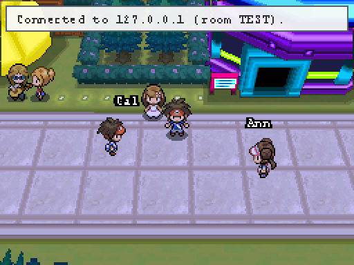
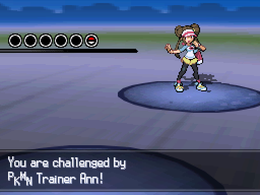

# Black 2 MMO

**Play Pokémon Black 2 online with your friends, all in the same Unova.**

Black 2 MMO is a mod for Pokémon Black 2 on the [BizHawk](https://github.com/TASEmulators/BizHawk)
emulator. Everyone plays their own game, and everyone sees everyone else walking around in it, as
real trainers, in real time. It's the Black 2 version of [ORAS MMO](https://github.com/droid-jpg/oras-mmo)
and speaks the same network protocol.

<p align="center">
  
  
</p>

## What you can do

- **See each other.** Friends on your map show up as their own trainer (Nate or Rosa, on their bike
  or surfing too), walking, running and turning as they do in their game, with their name above
  their head. They block your way like any trainer.
- **Talk to each other.** Walk up to a friend, face them and press **A**. Their greeting appears in
  the game's own text box, with a choice list: **Battle**, **Trade**, **Live battle** (and
  **Cancel**). Pick with the D-pad and **A**, back out with **B**. They see that you're talking to them.
- **Battle a friend's team.** Talk to them and pick **Battle**, or use **Battle their team** in the
  window: a real trainer battle against their party, under their name ("You are challenged by PKMN
  Trainer Ann!"), played by the game's AI. Win or lose, your party, EXP and money are put back afterwards.
- **Live battles.** Talk to a friend and pick **Live battle**. Their game asks "X challenges you to
  a live battle! Battle X now?": **Yes** starts it. Then you each pick your own moves on your own
  game, and the same battle plays out on both. Singles only. If your friend leaves, the game's AI
  plays their side to the end.
- **Watch a battle.** When a friend is in a battle (against a wild Pokémon, a trainer or a friend),
  talk to them: a line says what each side has out, and the bottom screen shows both teams with HP
  bars until their battle ends. Press **B** to stop watching. Your own battles are sent to your
  friends automatically.
- **Trade.** In the window, or **Trade** in the talk menu: pick the Pokémon you offer, and the other
  side picks **Yes** (or uses **Accept** in the window). The server swaps them in both games at once.
  A Pokémon that evolves by trade evolves when it arrives: "X sent over Y!", then the evolution.
- **Doors.** On a building's door you see "Ann is inside" when a friend is in that building, or
  deeper in the place behind it (up to four doors). Off screen, the label sits at the edge with an
  arrow. Automatic: you don't need to do anything, and the mod remembers the doors you've walked through.
- **Chat.** In the Black 2 MMO window, type and press **Send**. In the game, press **Select** on the
  field for a quick list: "Hi!", "Follow me!", "Wait for me!", "Battle?", "Trade?", "/who", or
  **Type a message...** to use the game's keyboard (up to 10 letters, the D-pad and **A**). `/who`
  lists who's online and where.
- **Follow each other.** Hold **Tab** for the list of players and the town or route each one is
  on (and who is in a battle). You get a notice when a friend joins, arrives on your map, catches a
  Pokémon, evolves one or earns a badge.

## What you need

- [BizHawk](https://github.com/TASEmulators/BizHawk/releases) 2.9 or newer (Windows)
- **Your own** copy of Pokémon Black 2 (USA) as an `.nds` file (nothing from the game is included here)
- One person in the group hosts the server: that needs [Node.js](https://nodejs.org) 18 or newer

## Install

1. Download `b2-mmo-…-windows.zip` from the [latest release](https://github.com/droid-jpg/b2-mmo/releases/latest)
   and unzip it.
2. Double-click **Install Black 2 MMO.bat**. It asks for your name, the server address, a room code,
   where BizHawk is and where your ROM is.
3. Double-click **Play Black 2 MMO.bat**. BizHawk starts the game with the mod and opens the
   Black 2 MMO window next to it.

## Hosting a game

One person double-clicks **Start server.bat** (in the zip). It prints the address everyone else
types in when installing.

- **Same Wi-Fi / house:** that's it.
- **Over the internet:** the easiest way is [Tailscale](https://tailscale.com) (free) on everyone's
  computer, then use the host's Tailscale address. Or forward TCP port **7777** on the host's router.

Everyone who types the same room code ends up in the same world.

## Good to know

- It's early. Expect rough edges, and back up your save before playing.
- Pokémon Black 2 (USA) only for now (not White 2 or other languages yet).
- Trades are the mod's own, not the game's link trade.
- Live battles are singles only and haven't been played over the internet yet. Bag items aren't
  restored after a live battle, and terrain isn't equalised.
- Chat is up to 10 letters per message; typing on the touch screen is untested.

Found a bug? [Open an issue](https://github.com/droid-jpg/b2-mmo/issues).

---

## For developers

| Folder | What's in it |
|---|---|
| `arm/` | The code that runs inside the game (C, ARMv5TE Thumb): reports the player, shows friends as the game's own other-player actors, swaps parties for trades and battles, and one file per feature (talk box, chat keyboard, live battles, watching, trade evolutions, friends' bikes and surf) |
| `lua/` | The BizHawk script: injects `arm/`, networking, names over heads, notices, the window. `lua/features/*.lua` holds one file per feature (talk, live, watch, evolve, chat, doors, ride), each with its header comment |
| `server/` | The relay server, Node with no dependencies: `node server/server.mjs [port]` |
| `tools/` | `fakefriend.mjs`, a test player that joins a room and walks, chats, trades and lends its team, with plugins in `tools/ff/` ([`tools/ff/README.md`](tools/ff/README.md)); `pkedit.mjs`, a party editor (`show`, `edit`, `pick`, `selftest`) for Gen 5 party dumps |
| `test/` | BizHawk tests with fake friends: [`test/README.md`](test/README.md) |
| `package/` | The Windows installer and launchers that go in the zip |
| `scripts/` | Build, packaging and the generators for the zone and species tables |
| `docs/` | [`NOTES.md`](docs/NOTES.md): how it was reverse-engineered and how it works |

[`PROTOCOL.md`](PROTOCOL.md) describes the wire format and [`STATUS.md`](STATUS.md) what's tested
and what's next.

### Build

```bash
bash scripts/build.sh     # needs devkitARM (WSL or Linux) and python3 -> lua/mmo_code.lua
bash scripts/package.sh   # optional: dist/b2-mmo-<version>-windows.zip
```

Or run straight from the repo: open the ROM in BizHawk, then *Tools → Lua Console → Open Script*
and pick `lua/b2mmo.lua` (settings in `lua/b2mmo.ini`, see `package/install.ps1`).

GitHub Actions builds the zip on every push; pushing a `v*` tag publishes a release.

### Credits

Addresses, names and structures come from the [pokebw2](https://github.com/fuddlesworth/pokebw2)
decompilation of Black 2 / White 2 (and the [swan](https://github.com/ds-pokemon-hacking/swan) names
it uses); `lua/zones.lua` and `lua/species.lua` are generated from its constant lists.
The relay server and protocol are ORAS MMO's.

Pokémon is © Nintendo / Creatures Inc. / GAME FREAK inc. This is an unofficial fan project and
contains no game code or assets.
